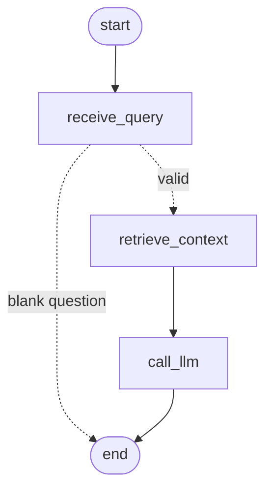

# Day 15 workflow graph

| Node | Reads from state | Writes to state | Can fail? |
|---|---|---|---|
| `receive_query` | `question`, `top_k` | normalised `question`, default `top_k` (or `answer`+`source=invalid_input`) | no I/O |
| `retrieve_context` | `question`, `top_k` | `chunks` | embedding API / index errors |
| `call_llm` | `chunks`, `question` | `answer`, `confidence`, `source` | LLM errors → `fallback_error` |

State reducers: `trace` (append) and `timings` (merge) so nodes add information instead of overwriting it.
