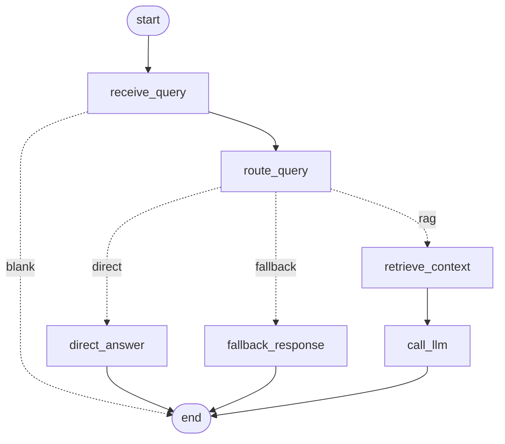

# Day 16 workflow graph

| Route | Chosen when | Path | API calls |
|---|---|---|---|
| `direct` | greeting / thanks / goodbye | `direct_answer` | 0 |
| `fallback` | too short or unintelligible | `fallback_response` | 0 |
| `rag` + `simple` | one fact/topic | retrieve (top_k ≤ 3) → call_llm | 1 embedding + 1 LLM |
| `rag` + `complex` | comparison / several topics | retrieve (top_k ≥ 6, wide margin) → call_llm | 1 embedding + 1 LLM |

Decision state written by `route_query`: `route`, `query_type`, `route_reason`, `routed_by` (`rule` | `llm`).
