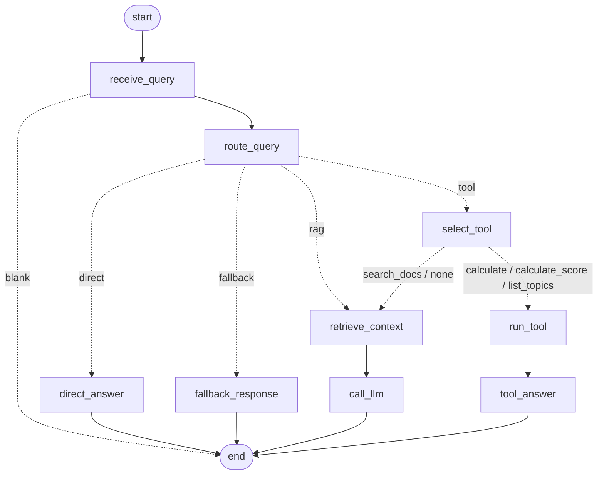

# Day 17 workflow graph

## Tool contract

| Tool | Input (Pydantic) | Output contract | Rejected when |
|---|---|---|---|
| `search_docs` | `query` 2..1000 chars, `top_k` 1..10 | list of `{topic, text, score}` | bad arguments; malformed hits |
| `calculate` | `expression` ≤ 100 chars | finite number | not arithmetic, `1/0`, exponent > 100, names/calls |
| `calculate_score` | `values` 1..20 numbers, optional `weights` | finite number | length mismatch, negative or all-zero weights |
| `list_topics` | optional `category` | non-empty list of strings | unknown category |

Validation order: **input model → run → output check → (only then) the LLM sees the result.**
