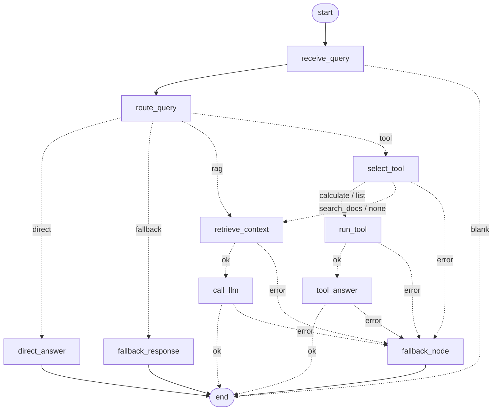

# Day 18 workflow graph (routing + tools + failure handling)

## Failure points and what happens

| Node | Can fail because | Handling | User sees |
|---|---|---|---|
| `retrieve_context` | embedding API down/timeout/429, corrupt index | retry (transient only) → `fallback_node` | "service temporarily unavailable" |
| `call_llm` | LLM down/timeout/429/invalid JSON | retry (transient only) → `fallback_node` | unavailable message **plus the best retrieved passage** |
| `select_tool` | LLM tool choice | already fails safe to `search_docs`; anything else → fallback | – |
| `run_tool` | bug in a tool | `execute_tool` never raises; a bug is caught by `safe` → fallback | "could not complete that calculation or lookup" |
| `tool_answer` | LLM down | returns the raw validated tool result | the number/list itself |
| any node | unexpected exception | `safe(...)` boundary → `state["error"]` → fallback | safe message, error logged with context |

Not failures: weak retrieval context (`no_context` refusal) and tool errors like `1/0` (`tool_error`) are *expected outcomes* and stay on the normal path.
