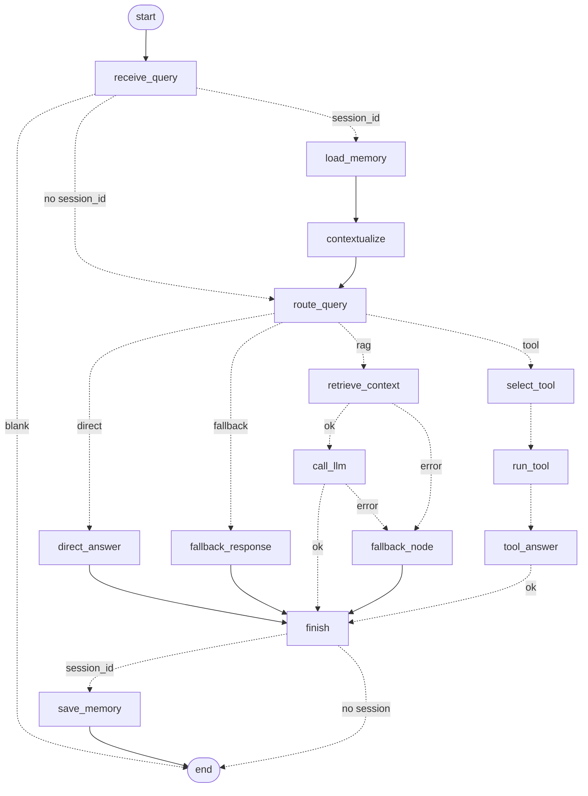

# Day 19 workflow graph (routing + tools + failure handling + memory)

| Memory node | Reads | Writes |
|---|---|---|
| `load_memory` | store: last turns (budgeted) + long-term facts | `history`, `user_facts`, `memory_used` |
| `contextualize` | `history`, `question` | `standalone_question` (only for context-dependent follow-ups; never for smalltalk) |
| `save_memory` | `question`, `answer`, `source` | stores the turn (not error answers) and extracted facts |
