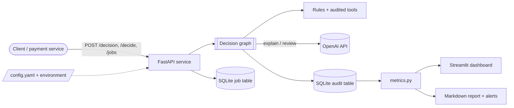
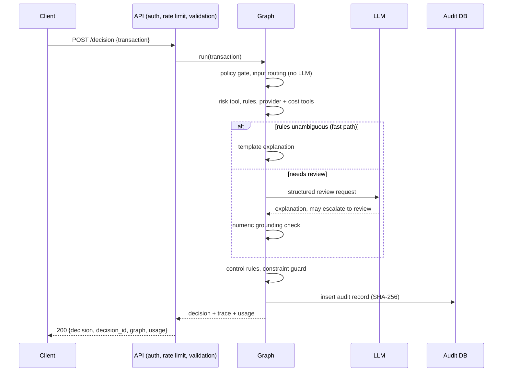
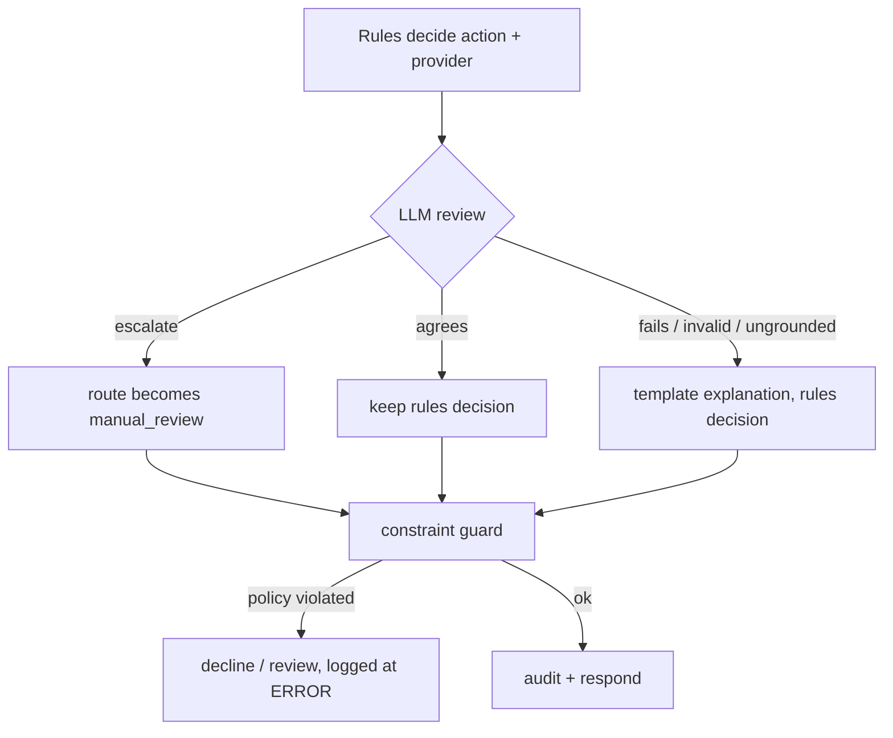
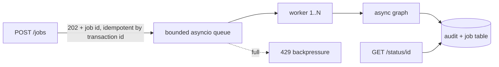

# System overview (end of Week 3)

## Context

## One request, in time

## Where the LLM may and may not act

The LLM has no path to `route` from `decline` or `manual_review`.

## Asynchronous work

## Configuration and modes

| Layer | Source | Notes |
|---|---|---|
| 1 | code defaults | `config.py` |
| 2 | `config.yaml` | non-secret tunables, thresholds, model, temperature |
| 3 | environment | always wins; the only source of secrets |

`allowed_modes` (default `graph`) decides which of baseline / ai / graph `/decide` accepts; the other two lack the safety layers.

## Data model (audit table)

| Column group | Content |
|---|---|
| identity | decision_id, transaction_id, created_at, agent_version |
| outcome | action, provider, reason codes, risk score, explanation |
| process | route, graph trace, llm_status, fast_path, guard override |
| cost | tokens, estimated cost, latency |
| integrity | SHA-256 of the row |
